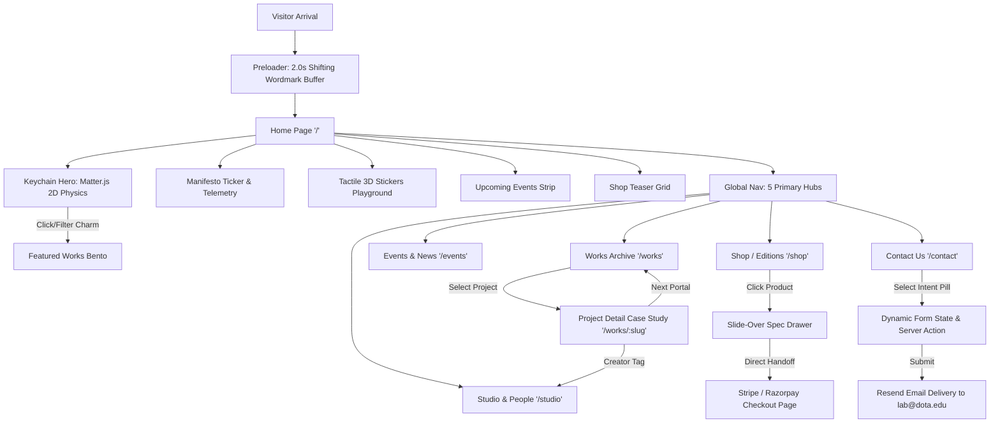
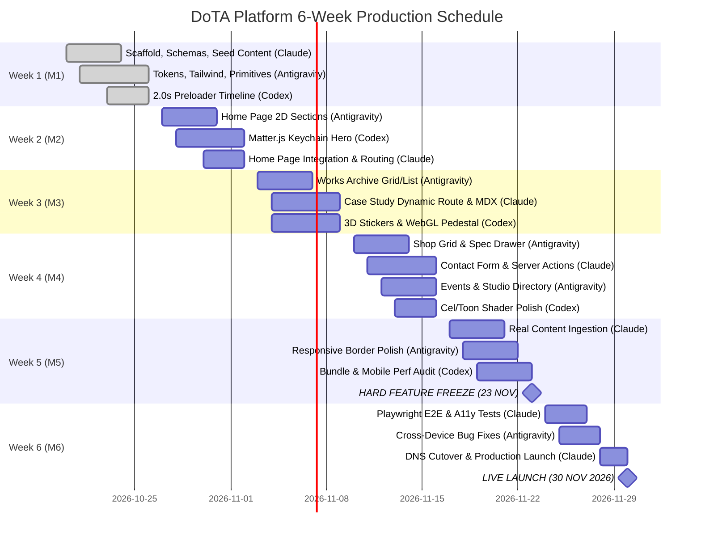
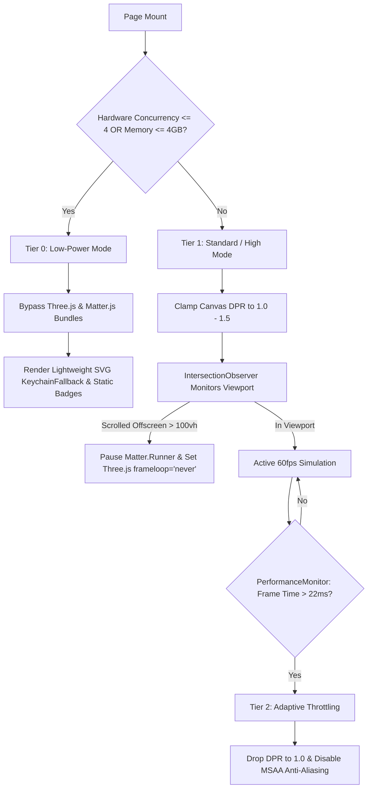

# WORKFLOW.md — End-to-End Production & Development Workflow for DoTA Platform

This document outlines the complete operational, architectural, and engineering workflow for the **Department of Technical Arts (DoTA)** portfolio platform. It translates the 44-page blueprint into an executable multi-phase roadmap spanning user experience journeys, content lifecycle, multi-agent development isolation, quality gates, and deployment.

---

## 1. Information Architecture & Route Workflow



### Route Purpose & Composition Matrix

| Route Path | Page Title | Primary Layout Structure | Key Reference Source | Signature Interaction |
| :--- | :--- | :--- | :--- | :--- |
| `/` | **Home** | Vertical bento stack on Cream (`#F5F5DC`) canvas | `noth.in` + `wildyriftian.com` | 2.0s preloader reveal; 5-charm draggable rigid-body physics keychain; raycasted 3D badges |
| `/works` | **Works Archive** | Sticky tab control bar + dual view (Grid / List) | `wildyriftian.com` + `k95.it` | Folder-tab category switches (`01–05`); Grid/List view toggle; cursor-tracked preview thumbnail |
| `/works/[slug]` | **Project Detail** | 16:9 media hero + asymmetric 4/8 sticky metadata split | `noth.in` + `wildyriftian.com` | Sticky left credits card with creator badges, stack tags, live iframe embed, next-project portal |
| `/events` | **Events & Exhibitions** | Live countdown telemetry header + bracketed rows | `noartmusic.com` | Bracketed `[01]` row accordion expansions; poster reveal; 1-click `.ics` calendar download |
| `/shop` | **Shop / Editions** | 4-column 1px collapsed border architectural grid | `emergenceprojects.com` | 350ms dual-image hover cross-fade (`1.03x` zoom); slide-over Spec Drawer; Razorpay/Stripe checkout handoff |
| `/studio` | **Studio & People** | Consolidated Manifesto + 5 Pillars + Roster | `noth.in` + `k95.it` + `hirotos.com` | Interactive 3D badge inspection per track; filterable Faculty / Student Cohort 2026 directory |
| `/contact` | **Contact Us** | 12-column asymmetric split (Cols 1–5 info / 6–12 form) | `k95.it/en` | Pill-tag intent selector; bottom-border-only hairline inputs; K95 split-character hover submit |

---

## 2. Primary Visitor Experience Workflows

### Journey A: Prospective Student (Discovery -> Engagement -> Inquiry)
1. **Landing & Wow Factor**: Arrives on `/`. The 2.0s Nothin'-inspired preloader cycles 6 generative textures through the DoTA wordmark, resolving via an `expo.inOut` clip-path expansion into the interactive hero.
2. **Tactile Exploration**: Interacts with the `Matter.js` 2D keychain, grabbing and flinging the `[01 GAME ARTS]` and `[02 SHADERS & VFX]` charms.
3. **Curriculum & Project Discovery**: Double-clicking a charm scrolls and filters the Featured Works section. Selecting a project card navigates to `/works/[slug]` to examine live GLSL shaders, tech stacks, and student credits.
4. **Institutional Validation**: Jumps to `/studio` to explore the 5 academic pillars and review physical lab facilities.
5. **Conversion**: Clicks `CONTACT ->` in the header, landing on `/contact` with the `[Prospective Student]` pill selected. Submits credentials and portfolio link for admissions review.

### Journey B: Industry Recruiter / Studio Partner (Vetting -> Identification -> Outreach)
1. **Rapid Scanning**: Enters `/works` directly. Clicks the `[ LIST ]` toggle to switch from visual grid to dense list view.
2. **Technical Filtering**: Filters by tech stack (`Unreal Engine 5`, `GLSL`, `Rust`, `TouchDesigner`) with cursor-following thumbnail previews.
3. **Creator Attribution**: Opens a standout capstone case study. The sticky sidebar (Cols 1–4) exposes the student lead's profile, GitHub repo, and direct portfolio.
4. **Direct Outreach**: Clicks creator link to view their cohort profile on `/studio#cohort-2026`, or clicks "Contact Studio" to load `/contact` with `[Industry / Recruiter]` pre-selected.

### Journey C: Current Student (Event Tracking -> Merch Acquisition -> Portfolio Contribution)
1. **Calendar Sync**: Visits `/events` to check the live countdown for the upcoming Game Jam. Clicks `Add to Calendar` to trigger 1-click `.ics` download.
2. **Merchandise Purchase**: Navigates to `/shop`, hovers over the `[ED-01]` hardware kit to inspect the detail photo cross-fade, opens the Spec Drawer, selects a size, and clicks `[ PROCEED TO ACQUISITION -> ]` to complete checkout on Razorpay.
3. **Project Publishing Workflow**: To add their graduating project to the site, opens a GitHub Pull Request adding `src/content/projects/my-project.mdx` with cover photo and video preview. GitHub Actions runs `pnpm content:validate` to ensure schema conformance before merging.

### Journey D: Faculty / Parents / General Public (Mission -> Credentials -> Degree Show)
1. **Institutional Mission**: Reads the high-impact manifesto on `/` and `/studio`.
2. **Faculty Profiles**: Inspects credentials, research lab publications, and student career outcomes.
3. **Exhibition Attendance**: Checks `/events` for date, venue, and campus map directions for the Annual Technical Arts Degree Show.

---

## 3. Six-Week Development Timeline (20 Oct – 30 Nov 2026)



---

## 4. Multi-Agent Development & Git Worktree Workflow

To ensure 100% conflict-free parallel engineering between the three autonomous AI coding agents, the codebase enforces strict branch and directory ownership using **Git Worktrees**.

### Worktree Setup
```bash
# Repository root setup
git clone <repo-url> dota-root
cd dota-root

# Create isolated worktree for Lead Systems Architect (Claude Code)
git worktree add ../dota-core feat/core

# Create isolated worktree for UI & Design System Engineer (Google Antigravity)
git worktree add ../dota-ui feat/ui

# Create isolated worktree for Creative Technologist & Physics Specialist (OpenAI Codex)
git worktree add ../dota-canvas feat/canvas
```

### Strict Directory Ownership Boundaries

| Agent Name | Dedicated Git Branch | Exclusive Write Access (Owned Directories) | Read-Only Boundaries |
| :--- | :--- | :--- | :--- |
| **Claude Code** | `feat/core` | `src/lib/**`<br>`src/content/**`<br>`src/app/actions/**`<br>`src/app/api/**`<br>`src/app/**/page.tsx`<br>`package.json`, `next.config.ts`, `e2e/**` | `src/components/canvas/**`<br>`src/components/ui/**` |
| **Google Antigravity** | `feat/ui` | `src/components/ui/**`<br>`src/components/sections/**`<br>`src/styles/**`<br>`tailwind.config.ts` | `src/components/canvas/**`<br>`src/lib/schemas.ts` |
| **OpenAI Codex** | `feat/canvas` | `src/components/canvas/**`<br>`src/lib/performance.ts` | `src/components/ui/**`<br>`src/components/sections/**`<br>`src/content/**` |

### Milestone Merge Protocol
At the conclusion of each milestone week, branches merge into `main` in strict sequential order:
1. `feat/core -> main` (Locks types, schemas, and API contracts)
2. `feat/ui -> main` (Integrates visual primitives and section compositions)
3. `feat/canvas -> main` (Plugs in dynamic WebGL/Matter.js canvas elements)

**Mandatory Merge Verification Gate**:
```bash
pnpm typecheck && pnpm lint && pnpm content:validate && pnpm build
```

---

## 5. Step-by-Step 14-Stage Execution Plan

### Stage 1: Project Scaffold, Type Schemas & Seed Content
- **Owner**: Claude Code (`feat/core`)
- **Key Deliverables**:
  - Configure Next.js 15 / Vite React setup, TypeScript (`strict: true`), Tailwind CSS, and Geist fonts.
  - Create `src/lib/schemas.ts` defining strict Zod schemas for `Project`, `Person`, `Event`, `Product`, and `ContactSubmission`.
  - Create `src/lib/content.ts` with typed loaders and validation script `pnpm content:validate`.
  - Populate initial 8 studio-grade seed projects, 12 people, 6 events, and 6 products.

### Stage 2: Design Tokens & Tailwind Theme Configuration
- **Owner**: Google Antigravity (`feat/ui`)
- **Key Deliverables**:
  - Implement `src/styles/tokens.css` with exact brand hexes (`#F5F5DC`, `#000000`, `#31C4B8`, `#C92D1C`, `#135C56`, `#4A4A42`), fluid clamp typography, and spacing tokens.
  - Implement `tailwind.config.ts` with brutalist shadows (`4px 4px 0px #000000`) and custom transition timing curves.
  - Implement `src/styles/globals.css` with `.hairline-grid` and global `:focus-visible` styling.

### Stage 3: Global Layout, Navbar, Footer & Core UI Primitives
- **Owner**: Google Antigravity (`feat/ui`)
- **Key Deliverables**:
  - Build `SplitTextHover.tsx` (K95 duplicated vertical roll).
  - Build `CornerTelemetry.tsx` (4-corner label wrapper).
  - Build `Button.tsx` (Primary Red with hard brutalist shadow; Secondary Cream).
  - Build `Tag.tsx` (Filter pill supporting all 5 interactive states).
  - Build `Navbar.tsx` (Fixed 56px, brand monogram, live Hyderabad coordinates, audio/FX toggle).
  - Build `Footer.tsx` (Black `#000000` surface, live IST clock, sitemap, giant DoTA wordmark).

### Stage 4: Buffer / Preloader Animation
- **Owner**: OpenAI Codex (`feat/canvas`)
- **Key Deliverables**:
  - Implement `src/lib/performance.ts` (`detectPerformanceTier()`, `useReducedMotion()`).
  - Build `Preloader.tsx` with GSAP timeline (0-1300ms 6-texture wordmark cycling + counter; 1300-2000ms `expo.inOut` clip-path reveal).
  - Dispatch `dota:preloader-complete` event to drop hero physics.
  - Implement instant bypass for `prefers-reduced-motion: reduce` or repeat visits.

### Stage 5: Home Page 2D Sections & Editorial Composition
- **Owner**: Google Antigravity (`feat/ui`)
- **Key Deliverables**:
  - Build `ProjectCard.tsx` (Wildy Riftian folder-tab container, 16:10 video preview, capability ticker).
  - Build `HomeSections.tsx` (`ManifestoSection`, `FeaturedWorksSection`, `UpcomingEventsStrip`, `ShopTeaserSection`).

### Stage 6: Interactive 2D Physics Keychain Hero
- **Owner**: OpenAI Codex (`feat/canvas`)
- **Key Deliverables**:
  - Build `KeychainHero.tsx` using `Matter.js` with 5 constrained bodies representing DoTA pillars.
  - Add pointer drag & fling (`Matter.MouseConstraint`), clamping DPR <= 2.
  - Enable `touch-action: pan-y` on mobile so empty space permits vertical scrolling.
  - Build `KeychainFallback.tsx` and keyboard-accessible `<ul className="sr-only">` charm list.

### Stage 7: 3D WebGL Elements & Cursor/Scroll Reactivity
- **Owner**: OpenAI Codex (`feat/canvas`)
- **Key Deliverables**:
  - Build `SceneCanvas.tsx` with Drei `<PerformanceMonitor>` and adaptive DPR `[1, 1.5]`.
  - Build `TactileSticker.tsx` (Extruded 3D badges with 3-tone cel shader, cursor tilt, and click deformation).
  - Build `ArtifactPedestal.tsx` (Morphing low-poly topological mesh reacting to category selection and scroll velocity).

### Stage 8: Works Archive Page & Project Detail Case Study
- **Owner**: Google Antigravity (8A — `WorksArchive.tsx`), Claude Code (8B — Case Study routes)
- **Key Deliverables**:
  - Build folder-tab filter bar (`01–05`), `[ GRID / LIST ]` toggle, and floating cursor preview thumbnail in List mode.
  - Wire `/works` and `/works/[slug]` with dynamic metadata, sticky metadata sidebar, live demo/shader embeds, and `<NextProjectPortal />`.

### Stage 9: Shop Section & Slide-Over Product Spec Drawer
- **Owner**: Google Antigravity (`feat/ui`)
- **Key Deliverables**:
  - Build `ShopSection.tsx` with collapsed 1px border grid.
  - Build `ProductCard.tsx` with 350ms dual-image cross-fade and price/acquire footer inversion.
  - Build `ProductSpecDrawer.tsx` (Accessible slide-over dialog, high-res gallery, size pills, external checkout link handoff).

### Stage 10: Contact Page, Studio/Events Pages & Server Actions
- **Owner**: Google Antigravity (10A — Forms & Views), Claude Code (10B — Server Action & Wiring)
- **Key Deliverables**:
  - Build `ContactForm.tsx` (K95 12-column layout, intent selection tags, bottom-border hairline inputs, split-text submit).
  - Build `src/app/actions/contact.ts` with Zod validation, honeypot spam prevention, and Resend email delivery.
  - Build `EventsList.tsx` and `PeopleDirectory.tsx` (`/studio`).

### Stage 11: Real Content Integration, Dynamic OG & AI-Readable SEO
- **Owner**: Claude Code (`feat/core`)
- **Key Deliverables**:
  - Ingest all final student capstone MDX files, headshots, and media assets.
  - Implement dynamic brutalist Open Graph image generator (`src/app/api/og/route.tsx`).
  - Inject semantic JSON-LD structured data (`EducationalOrganization`, `CreativeWork`, `Event`, `Product`).

### Stage 12: Performance Optimization & Mobile Audit Pass
- **Owner**: OpenAI Codex + Claude Code
- **Key Deliverables**:
  - Verify lazy loading (`ssr: false`) for all WebGL and physics bundles.
  - Ensure total first-load shared JS bundle is `< 110 KB` gzipped.
  - Verify explicit `.dispose()` cleanup on all Three.js geometries and textures during route changes.

### Stage 13: Accessibility & Reduced-Motion Verification Pass
- **Owner**: Claude Code + Google Antigravity
- **Key Deliverables**:
  - Run Playwright + `@axe-core/playwright` test suite across all 7 routes.
  - Verify zero instances of unstroked Cream on Teal.
  - Test 100% keyboard navigation traversal (`Tab`, `Shift+Tab`, `Enter`, `Escape`).
  - Validate instant reduced-motion bypass.

### Stage 14: Production Deployment, Headers & Launch Sign-Off
- **Owner**: Claude Code (`feat/core`)
- **Key Deliverables**:
  - Configure immutable asset caching headers (`max-age=31536000, immutable`).
  - Add brutalist 404 page (`not-found.tsx`).
  - Deploy to Vercel production with custom domain DNS and SSL.
  - Validate Lighthouse metrics and sign off for launch.

---

## 6. Performance Governor & Degradation Workflow

To guarantee smooth 60fps operation on desktop and >= 45fps on mid-range mobile devices ($0 budget infrastructure), the runtime executes an adaptive 3-tier performance governor:



---

## 7. Scope Shedding & MVIP Contingency Plan

If unexpected roadblocks emerge prior to the **23 November 2026 Feature Freeze**, non-essential features shed according to this strict priority order:

1. **Drop 1**: 3D Morphing Pedestal in Works Header (`ArtifactPedestal.tsx`) -> Replace with static SVG wireframe graphic.
2. **Drop 2**: Floating Cursor Preview in `/works` List View -> Keep row inversion without cursor-tracked image portal.
3. **Drop 3**: Custom GLSL Vertex Bend Deformation on 3D Badges -> Retain extruded 3D meshes and cursor tilt without vertex peel.
4. **Drop 4**: Slide-Over Shop Spec Drawer -> Allow card button to open hosted Stripe/Razorpay checkout link directly.

**Guaranteed Minimum Viable Impressive Product (MVIP)**:
Even with all 4 scope cuts exercised, the platform preserves 100% of its signature creative-studio identity:
- 2.0s Nothin' procedural texture wordmark preloader
- Matter.js 5-charm interactive keychain hero
- Hiroto Sato raycasted 3D department badges
- No Art Swiss exposed 1px grid & Geist Sans/Mono hierarchy
- Full 7-route functional architecture with K95 character-roll hover interactions
